# DailyPilotLab — Deep-Dive API Flow Analysis

Each API is analyzed across five dimensions:
1. 🧠 **Mental Flow** — The human intent behind triggering this API
2. ⚙️ **Logical Flow** — Step-by-step code execution path
3. 🔗 **Interconnectedness** — Services, functions, and tables it touches
4. 💥 **Overall Impact** — What changes in the system when it runs
5. 📍 **Where It Fits** — Its role in the application's lifecycle

---

## 1. `GET /ideas` — List All Ideas

### 🧠 Mental Flow
> "Show me everything I've captured so far."

The user (or a frontend) wants a full inventory of their thoughts — both raw rough drafts and polished refined ideas. This is the **read-all** operation, typically used to populate a dashboard or idea list view.

### ⚙️ Logical Flow
```
server.py → getIdeas()
  └─→ idea_manager.get_ideas()
        └─→ IdeaService.get_all_ideas()
              └─→ SQL: SELECT * FROM raw_idea
```
1. Route handler calls [get_ideas()](file:///d:/tilak/DailyPilotLab/utils/idea_manager.py#10-14) in [idea_manager.py](file:///d:/tilak/DailyPilotLab/utils/idea_manager.py#L10-L13)
2. Creates an [IdeaService](file:///d:/tilak/DailyPilotLab/services/ideas_service.py#7-241) instance
3. Executes a bare `SELECT *` against the [raw_idea](file:///d:/tilak/DailyPilotLab/utils/idea_manager.py#19-22) table
4. Returns all rows as a list of `IdeaOut` Pydantic models

### 🔗 Interconnectedness
| Component | Interaction |
|-----------|-------------|
| [IdeaService](file:///d:/tilak/DailyPilotLab/services/ideas_service.py#L7) | `.get_all_ideas()` — single SQL query |
| [dbConnection](file:///d:/tilak/DailyPilotLab/db/dbConnection.py) | `get_dict_cursor()` context manager |
| [raw_idea](file:///d:/tilak/DailyPilotLab/utils/idea_manager.py#19-22) table | Full table scan |

> [!NOTE]
> This endpoint has **no side effects** — it does not trigger LLM calls, writes, or cascading operations. It's purely read-only.

### 💥 Overall Impact
- **Zero mutations** — pure read
- Returns both raw (`raw=TRUE`) and refined (`raw=FALSE`) ideas
- Embedding vectors are included in the response (could be large payloads)

### 📍 Where It Fits
This is the **inventory endpoint**. It's at the top of the data lifecycle — the starting point for any UI that displays the user's collected thoughts. It sits before any processing (refinement, topic assignment) happens.

---

## 2. `POST /ideas` — Create a Single Idea

### 🧠 Mental Flow
> "I just had a thought, capture it."

The user throws a raw thought at the system. They don't care about categorization, refinement, or topic assignment — they just want it saved. The system, however, does a **lot** behind the scenes.

### ⚙️ Logical Flow
```
server.py → createIdea(idea)
  └─→ idea_manager.create_idea(idea)
        ├─ Empty? → return "No text to add"
        ├─→ helpers.classify_ideas([(1, content)])   ← LLM CALL #1
        │     ├─ Loads personal_state.json
        │     ├─ Loads ideaFiltering.yaml prompt
        │     └─ OpenAI structured output → ClassificationResultList
        │
        ├─ category == "gibberish"     → return "Gibberish text"
        ├─ category == "secrets"       → return "Can't save sensitive data"
        ├─ category == "personal_info" → helpers.update_personal_state()  ← LLM CALL #2
        │     ├─ Loads personal_info_updater.yaml prompt
        │     ├─ OpenAI → PersonalState
        │     └─ Writes merged result → personal_state.json
        │
        └─ category == "idea"
              ├─→ IdeaService.create_idea(data) → INSERT INTO raw_idea (raw=TRUE)
              └─→ Check: raw_count > TOPIC_AUTO_REFINEMENT_THRESHOLD?
                    └─ YES → raw_to_refined_ideas()  ← LLM CALL #3 + Embeddings
```

### 🔗 Interconnectedness
| Component | Interaction |
|-----------|-------------|
| [classify_ideas()](file:///d:/tilak/DailyPilotLab/utils/helpers.py#L15-L38) | LLM classification via `ideaFiltering.yaml` |
| [update_personal_state()](file:///d:/tilak/DailyPilotLab/utils/helpers.py#L40-L71) | LLM-powered personal info extraction + file write |
| [personal_state.json](file:///d:/tilak/DailyPilotLab/config/memory/personal_state.json) | Read (as LLM context) + Write (if personal info detected) |
| [IdeaService.create_idea()](file:///d:/tilak/DailyPilotLab/services/ideas_service.py#L75-L88) | SQL INSERT into [raw_idea](file:///d:/tilak/DailyPilotLab/utils/idea_manager.py#19-22) |
| [raw_to_refined_ideas()](file:///d:/tilak/DailyPilotLab/utils/idea_manager.py#L196-L220) | Auto-triggered refinement pipeline |
| OpenAI | 1-3 API calls depending on classification outcome |

### 💥 Overall Impact
- **Always**: 1 LLM call (classification)
- **If personal_info**: modifies `personal_state.json` on disk (persistent user profile mutation)
- **If idea**: new row in [raw_idea](file:///d:/tilak/DailyPilotLab/utils/idea_manager.py#19-22) with `raw=TRUE`, no embedding yet
- **If threshold exceeded**: triggers the **entire refinement pipeline** — deletes all raws, refines via LLM, generates embeddings, bulk inserts refined versions. This is a **heavy cascading side-effect**.

### 📍 Where It Fits
This is the **entry point** of the entire system — the very first step in the data lifecycle. Every idea begins life here. It's the gateway that decides: "Is this worth keeping?" via LLM classification. It can cascade into the refinement pipeline, making it deceptively powerful for a "create" endpoint.

---

## 3. `POST /ideas/bulk` — Create Multiple Ideas

### 🧠 Mental Flow
> "I have a batch of thoughts I jotted down. Ingest them all at once."

Batch insertion for when the user has collected multiple thoughts (e.g., from a notes app, voice transcription, etc.) and wants to add them in one go.

### ⚙️ Logical Flow
```
server.py → createIdeas(ideas)
  └─→ idea_manager.create_ideas(ideas)
        ├─ Exceeds BULK_IDEA_INSERTION_THRESHOLD? → reject
        ├─ Filter out empty content
        ├─ Only 1 valid? → delegate to create_idea() (single flow)
        ├─→ classify_ideas(all_ideas_as_batch)   ← SINGLE LLM call for entire batch
        ├─ Separate into: ideas[] + personal_info[]
        ├─ personal_info? → update_personal_state(personal_info)
        ├─ ideas? → IdeaService.bulk_create_ideas() → execute_values INSERT
        └─ raw_count > threshold? → raw_to_refined_ideas()
```

### 🔗 Interconnectedness
Same as `POST /ideas` but with **batch variants**:
- Uses `execute_values` for efficient multi-row INSERT (instead of per-row)
- Single LLM classification call for all inputs (cost-efficient)
- Same refinement cascade trigger

### 💥 Overall Impact
- More efficient than N × single `POST /ideas` calls (1 LLM call instead of N)
- Same cascading refinement risk as single create
- Enforces a hard limit via `BULK_IDEA_INSERTION_THRESHOLD` (default: 4)

### 📍 Where It Fits
Parallel entry point alongside `POST /ideas`. Exists for **throughput optimization** — fewer HTTP roundtrips, fewer LLM calls. Funnels into the same lifecycle after insertion.

---

## 4. `POST /ideas/update` — Update an Idea

### 🧠 Mental Flow
> "I want to edit this idea's text, or reassign it to different topics."

The user refines their own work — correcting a thought, re-categorizing it, or manually linking it to topics.

### ⚙️ Logical Flow
```
server.py → updateIdea(idea)
  └─→ idea_manager.update_idea(idea)
        ├─ Content changed? → openai_client.get_embeddings(new_content)
        │     └─ Sets idea.embeddings = new vector
        ├─→ IdeaService.update_idea(update_data) → UPDATE raw_idea SET ... WHERE id=X
        └─ topic_ids provided?
              ├─ override mode? → IdeaService.remove_idea_topic_relation(idea_id)
              └─ For each topic_id → IdeaService.add_idea_topic_relation(idea_id, topic_id)
```

### 🔗 Interconnectedness
| Component | Interaction |
|-----------|-------------|
| [OpenAI embeddings](file:///d:/tilak/DailyPilotLab/utils/openAi.py) | New embedding if content changes |
| [IdeaService.update_idea()](file:///d:/tilak/DailyPilotLab/services/ideas_service.py#L122-L143) | SQL UPDATE on [raw_idea](file:///d:/tilak/DailyPilotLab/utils/idea_manager.py#19-22) |
| [IdeaService.add/remove_idea_topic_relation()](file:///d:/tilak/DailyPilotLab/services/ideas_service.py#L49-L63) | Junction table `idea_topics` manipulation |

### 💥 Overall Impact
- If content changes → 1 OpenAI embedding API call (cost + latency)
- Directly mutates [raw_idea](file:///d:/tilak/DailyPilotLab/utils/idea_manager.py#19-22) row
- Can reshape the topic graph by adding/removing junction table entries
- **Does NOT re-trigger refinement or classification** — treats the update as trusted user input

### 📍 Where It Fits
A **mid-lifecycle correction point**. After ideas are created and potentially refined, the user can manually tweak them. This is the human-in-the-loop override for the automated pipeline.

---

## 5. `POST /ideas/delete` — Delete Single Idea

### 🧠 Mental Flow
> "This idea is no longer relevant, remove it."

### ⚙️ Logical Flow
```
server.py → deleteIdea(idea)
  └─→ IdeaService.delete_idea(idea.id)
        └─→ SQL: DELETE FROM raw_idea WHERE id = %s
              └─ CASCADE → idea_topics entries auto-deleted
```

### 🔗 Interconnectedness
| Component | Interaction |
|-----------|-------------|
| [raw_idea](file:///d:/tilak/DailyPilotLab/utils/idea_manager.py#19-22) table | Row deletion |
| `idea_topics` junction | Cascade delete (FK constraint) |

### 💥 Overall Impact
- **Destructive**: permanently removes the idea and all its topic associations
- Topics survive but lose their link to this idea
- Topic metrics (`lifetime_size`, `activity_*`) become stale until next recency refresh

### 📍 Where It Fits
End-of-life for a single idea. The cleanup mechanism.

---

## 6. `POST /ideas/delete/bulk` — Bulk Delete Ideas

### 🧠 Mental Flow
> "Clean up multiple ideas at once."

### ⚙️ Logical Flow
```
server.py → deleteIdeas(idea_ids)
  └─→ IdeaService.bulk_delete_ideas(idea_ids)
        └─→ SQL: DELETE FROM raw_idea WHERE id = ANY(%s)
```

### 💥 Overall Impact
Same as single delete but uses `ANY()` for batch efficiency. Same cascade behavior.

### 📍 Where It Fits
Batch cleanup — used when pruning multiple ideas from a list view or after a review session.

---

## 7. `POST /ideas/delete/all` — Delete All Ideas

### 🧠 Mental Flow
> "Wipe the slate clean. Start over."

### ⚙️ Logical Flow
```
server.py → deleteAllIdeas()
  └─→ IdeaService.delete_all_ideas()
        └─→ SQL: DELETE FROM raw_idea
              └─ CASCADE → all idea_topics entries deleted
```

### 💥 Overall Impact
- **Nuclear option**: removes every idea AND every idea→topic link
- Topics remain but become empty shells (no ideas assigned)
- The semantic search becomes useless until new ideas are added and assigned

### 📍 Where It Fits
System reset. Only used during development/testing or a deliberate fresh start.

---

## 8. `GET /topics/assign` — Assign Ideas to Topics ⭐

### 🧠 Mental Flow
> "I've accumulated refined ideas. Organize them into meaningful clusters."

This is the **brain of the system** — it takes unstructured refined ideas and creates structure (topics) around them. The user triggers this when they want the system to "make sense" of their accumulated thoughts.

### ⚙️ Logical Flow
```
server.py → assignTopics()
  └─→ helpers.assign_idea_to_topic()
        │
        ├─── PHASE 1: Vector Similarity (DB-level) ──────────────
        │   ├─ threshold = 1 - TOPIC_ASSIGNMENT_THRESHOLD_SIMILARITY
        │   └─→ IdeaService.assign_idea_to_topic(threshold)
        │         └─→ SQL: SELECT * FROM assign_and_return_matches(%s)
        │               └─ Supabase function: pgvector cosine match of
        │                  unassigned ideas ↔ existing topic embeddings
        │                  → auto-inserts into idea_topics
        │
        ├─── PHASE 2: LLM Organization (fallback) ──────────────
        │   ├─→ IdeaService.get_unassigned_ideas()
        │   │     └─→ SQL: LEFT JOIN idea_topics WHERE topic_id IS NULL
        │   ├─ No unassigned left? → return success
        │   ├─→ topic_manager.get_all_topics()
        │   ├─→ helpers.organize_ideas_into_topics(unassigned, topics)  ← LLM CALL
        │   │     ├─ Loads topic_organization.yaml prompt
        │   │     ├─ Sends ideas + existing topics to OpenAI
        │   │     └─ Returns TopicsList (is_new: true/false per topic)
        │   │
        │   ├─ New topics → topic_manager.create_topics()
        │   │     ├─ Generates summary embeddings
        │   │     ├─ TopicsService.bulk_create_topics() → INSERT
        │   │     └─ Links ideas via idea_topics junction
        │   │
        │   └─ Existing topics → topic_manager.update_topics(append=True)
        │         ├─ TopicsService.bulk_update_topics() → UPDATE
        │         └─ Appends idea IDs to idea_topics junction
```

### 🔗 Interconnectedness
| Component | Interaction |
|-----------|-------------|
| [assign_idea_to_topic()](file:///d:/tilak/DailyPilotLab/utils/helpers.py#L134-L155) | Orchestrates both phases |
| [IdeaService.assign_idea_to_topic()](file:///d:/tilak/DailyPilotLab/services/ideas_service.py#L186-L190) | DB function call for vector matching |
| [organize_ideas_into_topics()](file:///d:/tilak/DailyPilotLab/utils/helpers.py#L74-L132) | LLM-based topic organization |
| [topic_manager.create_topics()](file:///d:/tilak/DailyPilotLab/utils/topic_manager.py#L33-L69) | Bulk topic creation + embedding generation |
| [topic_manager.update_topics()](file:///d:/tilak/DailyPilotLab/utils/topic_manager.py#L83-L96) | Existing topic updates + junction appends |
| OpenAI | Embeddings for new topic summaries + 1 LLM call |
| [raw_idea](file:///d:/tilak/DailyPilotLab/utils/idea_manager.py#19-22), [topic](file:///d:/tilak/DailyPilotLab/services/topics_service.py#15-19), `idea_topics` | All three tables are read/written |
| Supabase function `assign_and_return_matches()` | Server-side vector similarity |

### 💥 Overall Impact
- **Most complex endpoint** — touches every layer of the system
- Phase 1 is fast (pure DB), Phase 2 is expensive (LLM + embeddings)
- Creates **new topics** that didn't exist before
- Mutates `idea_topics` junction table extensively
- Shapes the entire knowledge graph structure

### 📍 Where It Fits
This is the **organization step** in the lifecycle — it runs AFTER ideas are refined (have embeddings). It converts a flat list of ideas into a structured topic graph. Without this, semantic search has no topic-level results.

```
POST /ideas → GET /refine-ideas → [GET /topics/assign] → GET /semantic-search
                                         ↑ YOU ARE HERE
```

---

## 9. `GET /refine-ideas` — Refine Raw Ideas

### 🧠 Mental Flow
> "Take my rough notes and turn them into clean, atomic statements."

The user (or auto-trigger) converts messy raw thoughts into polished, deduplicated, third-person atomic statements with embeddings. This is the **quality upgrade** step.

### ⚙️ Logical Flow
```
server.py → refineIdeas()
  └─→ idea_manager.raw_to_refined_ideas()
        ├─→ idea_manager.get_raw_ideas()
        │     └─→ IdeaService.get_ideas_with_filter('raw', TRUE)
        │           └─→ SQL: SELECT * FROM raw_idea WHERE raw = TRUE
        │
        ├─→ helpers.refine_raw_ideas(raw_texts)   ← LLM CALL
        │     ├─ Loads idea_refiner.yaml prompt
        │     ├─ OpenAI structured output → RefinedIdeaList
        │     └─ Returns deduped, atomic, third-person sentences
        │
        ├─→ idea_manager.delete_raw_ideas()
        │     └─→ SQL: DELETE FROM raw_idea WHERE raw = TRUE  ← DESTRUCTIVE
        │
        ├─→ openai_client.get_embeddings(refined_texts)  ← EMBEDDING CALL
        │
        └─→ IdeaService.bulk_create_ideas(refined_with_embeddings)
              └─→ INSERT refined ideas with raw=FALSE + embedding vectors
```

### 🔗 Interconnectedness
| Component | Interaction |
|-----------|-------------|
| [refine_raw_ideas()](file:///d:/tilak/DailyPilotLab/utils/helpers.py#L188-L206) | LLM refinement via `idea_refiner.yaml` |
| [delete_raw_ideas()](file:///d:/tilak/DailyPilotLab/utils/idea_manager.py#L188-L190) | Bulk delete of originals |
| OpenAI | 1 LLM call + 1 batch embedding call |
| [raw_idea](file:///d:/tilak/DailyPilotLab/utils/idea_manager.py#19-22) table | DELETE all raws + INSERT refined replacements |

### 💥 Overall Impact

> [!CAUTION]
> **Destructive + Constructive**: Original raw ideas are permanently deleted and replaced with refined versions. The original wording is **irrecoverably lost**.

- Changes the count and content of ideas in the DB
- Refined ideas get embeddings (making them searchable)
- New ideas get new IDs (old IDs are gone → any junction table refs cascade-deleted)
- This breaks any existing topic assignments — refined ideas are "orphans" until topic assignment runs

### 📍 Where It Fits
The **transformation step** — it sits between capture and organization:
```
POST /ideas → [GET /refine-ideas] → GET /topics/assign → GET /semantic-search
                   ↑ YOU ARE HERE
```

---

## 10. `GET /semantic-search?query=...` — Semantic Search

### 🧠 Mental Flow
> "Find ideas related to 'machine learning' across all my topics."

The user wants to query their knowledge base semantically — not by keywords, but by **meaning**. The system finds relevant topics first, then drills into ideas within those topics.

### ⚙️ Logical Flow
```
server.py → semanticSearch(query)
  └─→ helpers.semantic_search_memories(query)
        ├─→ openai_client.get_embeddings(query)  ← EMBEDDING CALL
        │
        └─→ IdeaService.search_topics_and_ideas(
        │       query_embedding, n_topics=5, k_ideas=3,
        │       topic_similarity_threshold, idea_similarity_threshold
        │   )
        │     └─→ SQL (single CTE query):
        │           WITH top_topics AS (
        │               SELECT topics WHERE summary_embedding <=> query < threshold
        │               ORDER BY distance LIMIT n_topics
        │           )
        │           SELECT topics + LATERAL JOIN (
        │               SELECT ideas WHERE embeddings <=> query < threshold
        │               LIMIT k_ideas per topic
        │           )
        │
        └─ Group results by topic → return structured JSON
```

### 🔗 Interconnectedness
| Component | Interaction |
|-----------|-------------|
| [semantic_search_memories()](file:///d:/tilak/DailyPilotLab/utils/helpers.py#L157-L185) | Orchestrator |
| [IdeaService.search_topics_and_ideas()](file:///d:/tilak/DailyPilotLab/services/ideas_service.py#L192-L240) | Complex CTE with pgvector |
| OpenAI | 1 embedding call for the query string |
| [topic](file:///d:/tilak/DailyPilotLab/services/topics_service.py#15-19) + [raw_idea](file:///d:/tilak/DailyPilotLab/utils/idea_manager.py#19-22) + `idea_topics` | Read-only joins across all three tables |

### 💥 Overall Impact
- **Read-only** — no mutations
- Single OpenAI embedding call (low cost)
- Performance depends on pgvector index quality and table sizes
- Returns a **two-level hierarchy**: topics → ideas within each topic
- Uses env-configurable thresholds (`TOPIC_SIMILARITY_THRESHOLD`, `IDEA_SIMILARITY_THRESHOLD`)

### 📍 Where It Fits
The **consumption endpoint** — the final step where the user reaps the benefits of the entire pipeline. It only works well after:
1. Ideas have been refined (have embeddings)
2. Topics have been assigned (ideas linked to topics)

```
POST /ideas → GET /refine-ideas → GET /topics/assign → [GET /semantic-search]
                                                             ↑ YOU ARE HERE
```

---

## 11. `GET /update-topic-recency` — Refresh Topic Metrics

### 🧠 Mental Flow
> "Recalculate which topics are 'hot' vs stale."

A maintenance operation that refreshes computed metrics on topics — activity counts, recency strength, and dominance scores. These metrics drive downstream features like trait extraction.

### ⚙️ Logical Flow
```
server.py → updateTopicRecency()
  └─→ topic_manager.update_topic_recency()
        └─→ TopicsService.refresh_topic_recency()
              └─→ SQL: SELECT update_topic_recency_metrics();
                    └─ Supabase function updates:
                         activity_7d, activity_30d, lifetime_size,
                         last_activity_at, recency_strength, dominance
```

### 🔗 Interconnectedness
| Component | Interaction |
|-----------|-------------|
| [TopicsService.refresh_topic_recency()](file:///d:/tilak/DailyPilotLab/services/topics_service.py#L172-L178) | Calls DB function |
| Supabase function `update_topic_recency_metrics()` | Server-side computation |
| [topic](file:///d:/tilak/DailyPilotLab/services/topics_service.py#15-19) table | Multiple columns updated |

### 💥 Overall Impact
- Updates **computed metrics** on every topic
- These metrics feed into `GET /update-traits` (determines which topics are "high-signal")
- Pure DB-side operation — no LLM calls
- Should be run periodically (cron-like) to keep metrics fresh

### 📍 Where It Fits
A **maintenance/background operation**. Not part of the main idea lifecycle but critical for the trait extraction pipeline:
```
[GET /update-topic-recency] → GET /update-traits
       ↑ YOU ARE HERE
```

---

## 12. `GET /update-traits` — Extract & Upsert User Traits

### 🧠 Mental Flow
> "Based on my most active topics, what kind of person am I? What are my interests, goals, skills?"

This is the **profiling engine**. It looks at which topics are most active (high recency or dominance) and uses an LLM to extract stable character traits about the user.

### ⚙️ Logical Flow
```
server.py → updateTraits()
  └─→ helpers.update_traits()
        ├─→ TopicsService.get_high_signal_topics(recency_threshold, dominance_threshold)
        │     └─→ SQL: SELECT id, title, summary FROM topic
        │           WHERE recency_strength >= X OR dominance >= Y
        │
        ├─ No high-signal topics? → return early
        │
        ├─ For each high-signal topic:
        │   └─→ TopicsService.get_recent_ideas_for_topic(topic_id, limit)
        │         └─→ SQL: SELECT content FROM raw_idea JOIN idea_topics
        │               WHERE topic_id = X ORDER BY created_at DESC LIMIT N
        │
        ├─ Build payload: [{ topic_title, topic_summary, memory_snippets[] }]
        │
        ├─→ helpers.extract_traits(payload_json)   ← LLM CALL
        │     ├─ Loads trait-extraction.yaml prompt
        │     ├─ OpenAI structured output → TraitExtractionResponse
        │     └─ Returns: [{ trait_text, trait_type, confidence_suggestion, evidence_bullet }]
        │
        └─→ TraitsService.process_and_upsert_traits(traits)
              └─ For each trait:
                    ├─→ Embed trait_text → vector
                    ├─→ SQL: SELECT FROM trait WHERE (embedding <=> vector) <= 0.12
                    │
                    ├─ MATCH FOUND (semantic duplicate):
                    │   ├─ EMA smoothing: new_conf = 0.9 * current + 0.1 * suggestion
                    │   ├─ Clamp change to [-0.03, +0.05]
                    │   └─→ UPDATE trait SET confidence = final, last_evidenced_at = NOW()
                    │
                    └─ NO MATCH (new trait):
                        ├─ Cap initial confidence at 0.5
                        └─→ INSERT INTO trait (trait_text, trait_type, confidence, embedding)
```

### 🔗 Interconnectedness
| Component | Interaction |
|-----------|-------------|
| [update_traits()](file:///d:/tilak/DailyPilotLab/utils/helpers.py#L237-L301) | Full pipeline orchestrator |
| [extract_traits()](file:///d:/tilak/DailyPilotLab/utils/helpers.py#L209-L234) | LLM call with [trait-extraction.yaml](file:///d:/tilak/DailyPilotLab/config/prompts/trait-extraction.yaml) |
| [TraitsService](file:///d:/tilak/DailyPilotLab/services/trait_service.py#L5-L67) | Embedding, dedup, EMA smoothing, upsert |
| [TopicsService.get_high_signal_topics()](file:///d:/tilak/DailyPilotLab/services/topics_service.py#L182-L203) | Filters by recency + dominance |
| [TopicsService.get_recent_ideas_for_topic()](file:///d:/tilak/DailyPilotLab/services/topics_service.py#L207-L222) | Fetches evidence snippets |
| OpenAI | 1 LLM call + N embedding calls (one per trait) |
| [topic](file:///d:/tilak/DailyPilotLab/services/topics_service.py#15-19), [raw_idea](file:///d:/tilak/DailyPilotLab/utils/idea_manager.py#19-22), `idea_topics`, [trait](file:///d:/tilak/DailyPilotLab/utils/helpers.py#237-302) tables | Reads from 3, writes to 1 |

### 💥 Overall Impact
- **Creates or updates the user's behavioral profile**
- Uses EMA (Exponential Moving Average) for gradual confidence evolution:
  - Change capped at +0.05 / -0.03 per update → prevents wild swings
  - New traits start capped at 0.5 confidence → must be re-evidenced to grow
- Semantic dedup threshold: cosine distance ≤ 0.12 (≈88% similarity = same trait)
- Multiple OpenAI API calls (1 LLM + N embeddings) — **expensive per invocation**

### 📍 Where It Fits
The **highest-level intelligence endpoint**. It sits at the very end of the entire pipeline and synthesizes everything:

```
POST /ideas → GET /refine-ideas → GET /topics/assign 
    → GET /update-topic-recency → [GET /update-traits]
                                        ↑ YOU ARE HERE
```

This is where the system transitions from **"what did the user say?"** to **"who is the user?"**

---

## System-Wide Interconnection Map

```mermaid
graph TD
    A["POST /ideas"] -->|classifies| B["LLM: classify_ideas()"]
    A -->|if personal info| C["personal_state.json"]
    A -->|if idea| D["raw_idea table"]
    A -->|if threshold| E["GET /refine-ideas"]

    F["POST /ideas/bulk"] -->|batch classifies| B
    F -->|inserts| D
    F -->|if threshold| E

    E -->|LLM refine| G["LLM: refine_raw_ideas()"]
    E -->|deletes raws| D
    E -->|inserts refined| D
    E -->|generates| H["OpenAI Embeddings"]

    I["GET /topics/assign"] -->|Phase 1: vector| J["DB: assign_and_return_matches()"]
    I -->|Phase 2: LLM| K["LLM: organize_ideas_into_topics()"]
    I -->|creates/updates| L["topic table"]
    I -->|links| M["idea_topics junction"]

    N["GET /semantic-search"] -->|embeds query| H
    N -->|CTE query| D
    N -->|CTE query| L
    N -->|CTE query| M

    O["GET /update-topic-recency"] -->|refreshes metrics| L

    P["GET /update-traits"] -->|reads high-signal| L
    P -->|reads evidence| D
    P -->|LLM extract| Q["LLM: extract_traits()"]
    P -->|upserts| R["trait table"]

    style A fill:#4CAF50,color:#fff
    style F fill:#4CAF50,color:#fff
    style E fill:#FF9800,color:#fff
    style I fill:#F44336,color:#fff
    style N fill:#2196F3,color:#fff
    style O fill:#9C27B0,color:#fff
    style P fill:#E91E63,color:#fff
```



---

## Complete Data Lifecycle Summary

| Stage | Endpoint | What Happens | LLM Calls |
|-------|----------|-------------|-----------|
| 1. **Capture** | `POST /ideas` or `/ideas/bulk` | Raw thought → classified → stored as `raw=TRUE` | 1-2 |
| 2. **Refine** | `GET /refine-ideas` | Raw ideas → atomic statements + embeddings | 1 + embeddings |
| 3. **Organize** | `GET /topics/assign` | Ideas → topics (vector + LLM) | 0-1 + embeddings |
| 4. **Search** | `GET /semantic-search` | Query → topic→idea hierarchy | 0 (1 embedding) |
| 5. **Metrics** | `GET /update-topic-recency` | Refresh activity/dominance scores | 0 |
| 6. **Profile** | `GET /update-traits` | Topics → user traits | 1 + N embeddings |
| ∞. **Manage** | Update/Delete endpoints | Manual corrections | 0-1 embedding |
